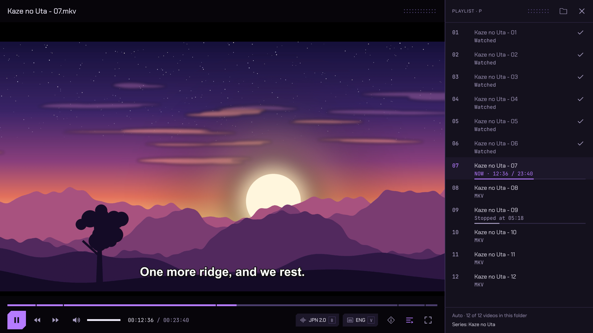
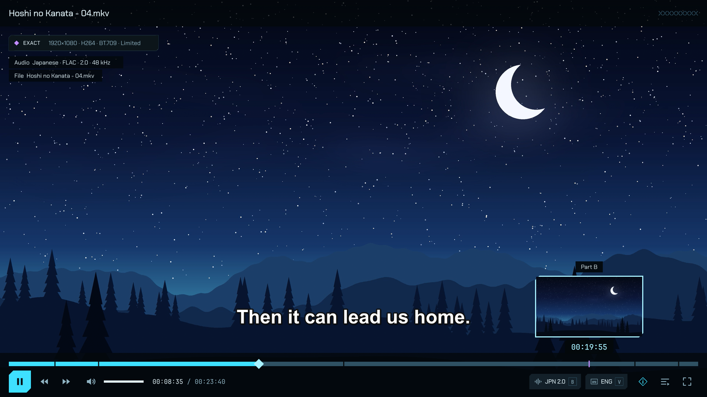
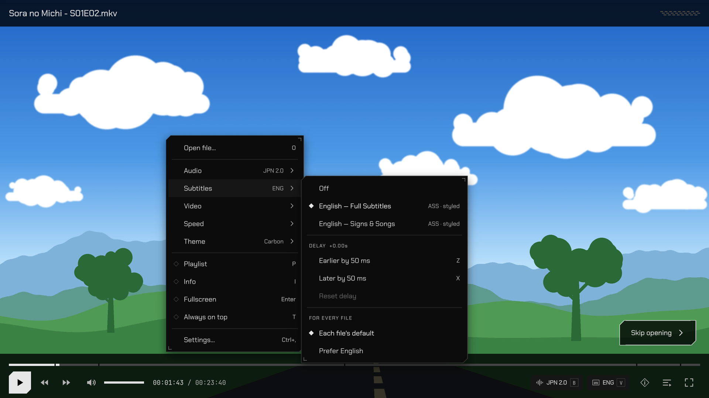
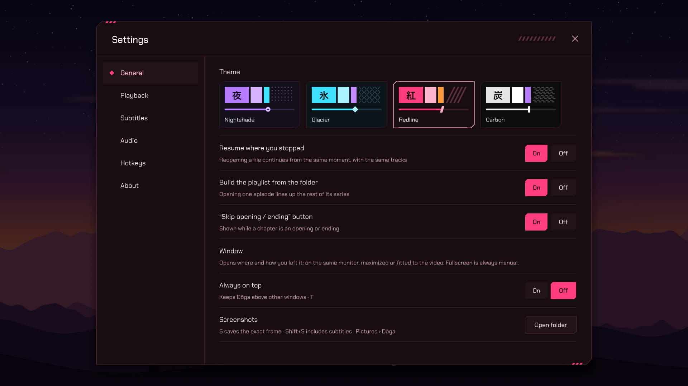
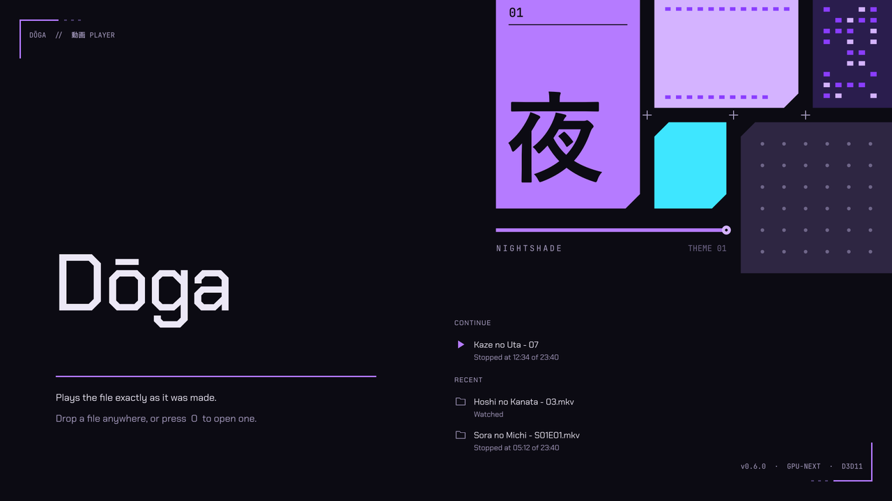
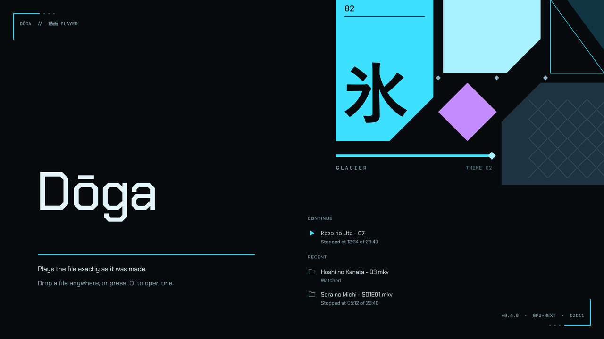
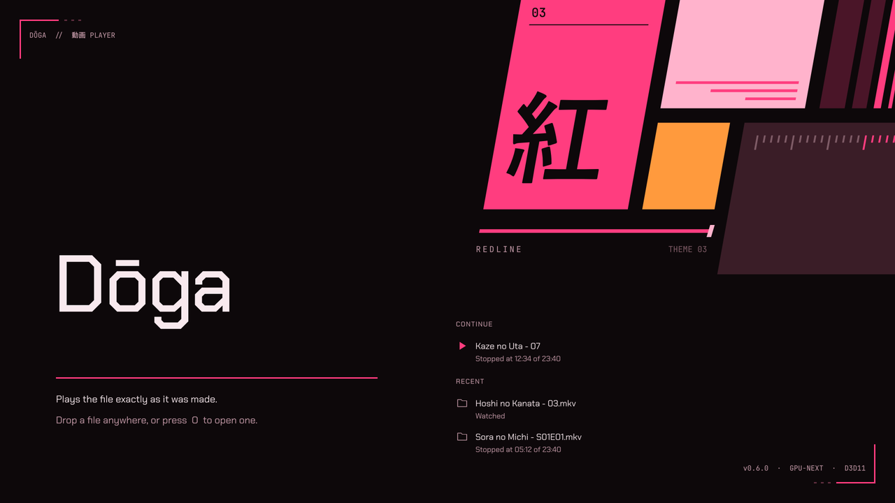
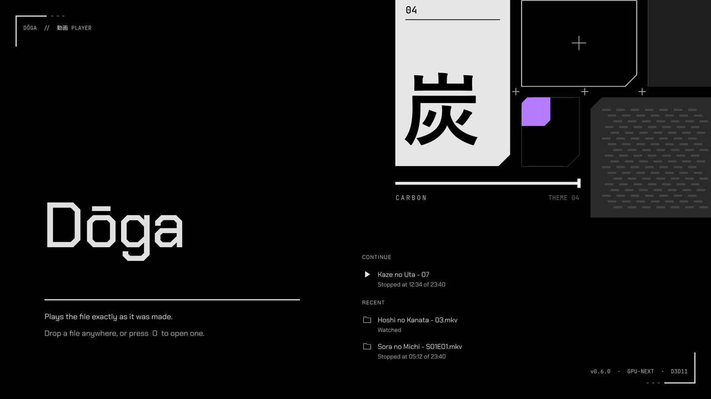

# Dōga

A video player for Windows that plays the file exactly as it was made: no colour "enhancement", no gain tricks, no feature bloat.



- **Engine:** libmpv (`gpu-next` / libplacebo on D3D11), the same engine as mpv.
- **Host:** a small Rust program with no dependencies (`src/`). It loads libmpv, applies the fidelity settings, fills the playlist with the opened file's series, and owns the Open dialog.
- **Scrub thumbnails:** `src/thumbs.rs`. A second, hidden libmpv instance (no window, no audio, created on first hover) decodes only the nearest keyframe, scales it to preview size and hands the UI a memory pointer. The hovered position goes first, and neighbouring slots fill in while idle. The main video never waits on it.
- **Chrome:** `ui/doga.lua`, drawn inside mpv's OSD layer so controls never lag or tear against the video.
- **Look:** four dark themes and the drawing kit live in `ui/kit.lua`; the app icon is `assets/icon.svg`.

## Screenshots

Hovering the seek bar shows the frame, chapter and time at that spot. The badge at the top left (**I**) says the picture is shown exactly as stored.



Right-click for everything else: tracks, subtitle delay, speed, theme. The "Skip opening" button appears only while an opening chapter plays.



Settings open over the video (**Ctrl+,**).



The video in these pictures is a set of test clips drawn for this page.

## Keys

| Key | Does |
| --- | --- |
| **B** / Shift+B | next / previous audio track |
| **V** / Shift+V | next / previous subtitle track (Off is part of the cycle) |
| Space, click | play / pause |
| Right-click | menu: open, audio, subtitles (+ delay), video (aspect, rotate, deinterlace, screenshot, copy frame), speed, theme, playlist, info, fullscreen, always on top |
| ← / → | 5 seconds back / forward |
| Shift+← / → or , / . | one frame |
| ↑ / ↓, wheel | volume |
| M | mute |
| Enter, F, double-click | fullscreen |
| P | playlist panel |
| Page Down / Page Up | next / previous in playlist |
| I | info (Exact / Passthrough / Tone-mapped) |
| O | open files |
| Z / X | subtitle delay −/+ 50 ms |
| Ctrl+Z / Ctrl+X | audio delay −/+ 50 ms (remembered; for Bluetooth headphones) |
| Home | back to the start |
| S / Shift+S | screenshot of the exact frame / with subtitles, PNG in Pictures\Dōga |
| Ctrl+C | copy the exact frame to the clipboard (picture only), ready to paste into a chat or an editor |
| T | always on top, on / off (remembered) |
| Ctrl+T | next theme (Nightshade, Glacier, Redline, Carbon) |
| Ctrl+, | Settings |
| Esc | close menu / leave fullscreen |
| Media keys | play/pause, next/previous, stop (keyboards, headphones, the Windows media overlay) |

## Settings

Open with right-click › Settings… or **Ctrl+,**. The video keeps playing dimmed behind it.

- **General:** theme; resume where you stopped; build the playlist from the folder; the Skip opening/ending button.
- **Playback:** seek step for ← → (3–30 s); hardware decoding (the picture is identical either way); your preferred audio and subtitle languages, with Clear.
- **Subtitles:** size (80–130%); whether dialogue moves above the controls.
- **Audio:** volume on launch (remember or always 100%); output device.
- **Hotkeys:** click a key, press the new one, Esc cancels. A key that's already taken moves over, and the old action shows "—". Reset all brings back the defaults.
- **About:** version and engine versions; update status with Check now and Daily/Never; the settings folder; GitHub and licenses.

Everything is saved in `%APPDATA%\Doga\settings.json`. Each save is written to a temporary file and swapped in, and the previous version is kept as `settings.json.bak`, so a crash or power cut mid-save can't leave you with empty settings.

## Themes

Four dark themes, switched with **Ctrl+T**, the right-click menu or Settings. A theme only changes the chrome: the picture and the black bars around it are identical in all four.

| Theme | Colour | Details |
| --- | --- | --- |
| **Nightshade** 夜 | violet on black-purple | dot grid, round seek thumb, neon corner brackets on panels |
| **Glacier** 氷 | ice cyan | cut-crystal facets, diamond seek thumb, double bevel on panels |
| **Redline** 紅 | hot pink-red | slanted speed stripes, blade seek thumb, stripe tab on panels |
| **Carbon** 炭 | pure-black OLED, white accent | twill weave, square seek thumb, registration ticks on panels |

| Nightshade 夜 | Glacier 氷 |
| --- | --- |
|  |  |
| **Redline 紅** | **Carbon 炭** |
|  |  |

Each theme also has its own start-screen cover, shown above. The installer and updater open in the theme you use.

## Little things that just work

- **Same monitor:** Dōga opens on the screen it was last on. Fullscreen covers the screen the window is on, so drag it to another monitor and it goes fullscreen there.
- **Resume:** files pick up where you stopped, with a short "Resumed at 12:34 · Start over" chip. Home goes back to the start.
- **Continue:** the start screen's first row is the file you stopped in, or, when you finished it, the next episode you haven't watched. One click and you're back in.
- **A clean start screen when you want one:** "Clear" beside the list empties Continue and Recent, and Settings › General › Recent files turns the list off for good (it is on by default). Clear only shows while there is something to clear. Watched marks and resume positions are kept either way.
- **Same tracks for a whole series:** pick the dub, or the "Signs & Songs" subtitles, or subtitles off, in one episode and the rest of the series opens the same way. The pick is matched by language and track name, so it still lands on the right track when an episode orders its tracks differently. It only ever applies to that series. Settings › Playback turns it off.
- **Watched marks:** the playlist shows a tick on episodes you finished and a thin line for how far you got in the ones you started.
- **The playlist follows along:** the panel opens with the playing episode in the middle and scrolls to keep it in view as the series goes on. Scrolling by hand is left alone until the next episode starts.
- **When something can't play:** a broken or unsupported file gets a plain message saying which file and why, and the playlist carries on.
- **One window:** opening a video while Dōga is already open plays it in that window. Several files opened together from Explorer become one playlist.
- **Preferred languages:** right-click › Audio or Subtitles › "For every file" › "Prefer Japanese" (or whichever language is playing). New files then pick that track automatically. Files you've already watched keep the tracks you chose for them.
- **Skip opening / ending:** when a file has chapters named like an opening or ending (OP, Opening, Intro, ED, Ending, Credits…), a "Skip" button appears for that chapter. Files without chapters never show it.
- **Drops:** drop videos on the playlist panel to insert them at that row. Drop them anywhere else to play them, or drop subtitle files to add them to the current video.

## Install

Run `dist\Doga-Setup.exe`. It installs just for you, with no admin rights, into `%LOCALAPPDATA%\Programs\Doga`. You can add:
- a Start menu shortcut (always) and a desktop shortcut,
- "Open with" registration for video files (Windows then asks you to confirm Dōga in Default apps),
- an entry in Settings › Apps. Uninstalling there removes exactly what setup created and keeps your settings in `%APPDATA%\Doga`.

**Portable:** each release also has `Doga-<version>-portable.zip`. Unzip it anywhere (a USB stick is fine) and run `doga.exe`: nothing is installed. The `portable.txt` beside the exe makes Dōga keep its settings, resume positions and recent files in a `data` folder there instead of `%APPDATA%`. A portable copy doesn't update itself; "Check now" opens the download page, and you replace `doga.exe`, `libmpv-2.dll` and the `ui` folder.

Build the installer yourself:

```bash
powershell -File tools/build-installer.ps1
```

The installer is `doga.exe` with a compressed payload appended (`src/pack.rs`; Windows' built-in XPRESS-Huffman compression). On launch it shows a native placeholder window at once, unpacks the engine to a temp folder, and draws its UI with the same engine and kit as the player (`ui/installer.lua`, `ui/kit.lua`). Run with `DOGA_SETUP_DRYRUN=1` (and optionally `DOGA_SETUP_DIR=<folder>`) to test without touching shortcuts or the registry.

## Updates

A few seconds after launch, at most once a day, Dōga asks GitHub whether there's a newer release. That request is the only thing it ever sends over the network. If a newer release exists, "Update to x.y.z" appears on the start screen and at the top of the right-click menu, and nothing interrupts what you're watching. Clicking it:
1. downloads the installer and its signature,
2. checks the signature against the key built into Dōga, and refuses anything that doesn't match,
3. updates in place, keeping your settings and choices, and reopens Dōga.

To switch the check off, go to Settings › About › Updates › Never. "Check now" still works whenever you click it.

### Releasing (maintainers)

- One time: `doga.exe --gen-update-key`. This writes the private key to `%USERPROFILE%\.doga-release\update.key` and the public key to `assets/update.pub`. Back up the private key and never commit it. Losing it means a new key, and everyone has to update by hand once.
- Each release: bump `version` in `Cargo.toml`, then run `tools/build-installer.ps1`. It builds, packs and signs `dist/Doga-Setup-<version>.exe(.sig)` and zips `dist/Doga-<version>-portable.zip`. Upload all three files to a GitHub release tagged `v<version>`.

## Startup animation

- **No file:** the start screen assembles itself in about 1.3 s, and a click skips it:
  - a scanline sweep,
  - HUD corner brackets drawing in, with labels typing beside them,
  - the theme's cover sliding in (each theme has its own) and the seek-bar line filling,
  - the name glitching in, with a divider drawing under it.

  It's laid out on a proportional canvas, so a small window, a maximized one and fullscreen 4K all look the same.
- **Opening a file:** the video starts immediately, and a neon frame traces the window edge over the first ~0.6 s.

Nothing waits on either.

## Build and run

```bash
cargo build --release
```

At runtime Dōga needs `libmpv-2.dll`. Put it next to `doga.exe`, or in `vendor/mpv/` while developing. Get it from the `mpv-dev-x86_64-*.7z` archive of [shinchiro/mpv-winbuild-cmake](https://github.com/shinchiro/mpv-winbuild-cmake/releases). Optional fonts go in `ui/fonts/`: Chakra Petch, JetBrains Mono and Noto Sans (all OFL). Without them the UI falls back to Segoe UI and Consolas.

```bash
cargo run -- "D:\Anime\Show - 01.mkv"
```

Every push and pull request is built and tested by GitHub Actions (`.github/workflows/ci.yml`: `cargo build`, then `cargo test`, on Windows).

Settings, resume positions, recent files and the tracks picked per series (`series.json`) are stored in `%APPDATA%\Doga`, or in `data\` beside `doga.exe` when a `portable.txt` sits there. A `cache` folder beside them holds compiled shaders, which is why the second launch onward opens faster; deleting it is harmless. The window opens the way you last left it: maximized, or windowed and fitted to the video. Fullscreen is always manual.

## Series detection

When you open one file, Dōga lists the other videos in its folder that are the same series: same name, with only the episode number or letter changing. `Anime 1`, `Anime 2`, `Anime 3` join; `Car 5` doesn't. Bracket tags like `[SubsPlease]`, `(1080p)` and `[A1B2C3D4]` are ignored, and when a name has several numbers, the one that changes across the folder is the episode. Tests are in `src/series.rs` (`cargo test`).
